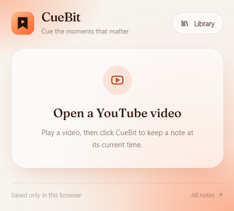
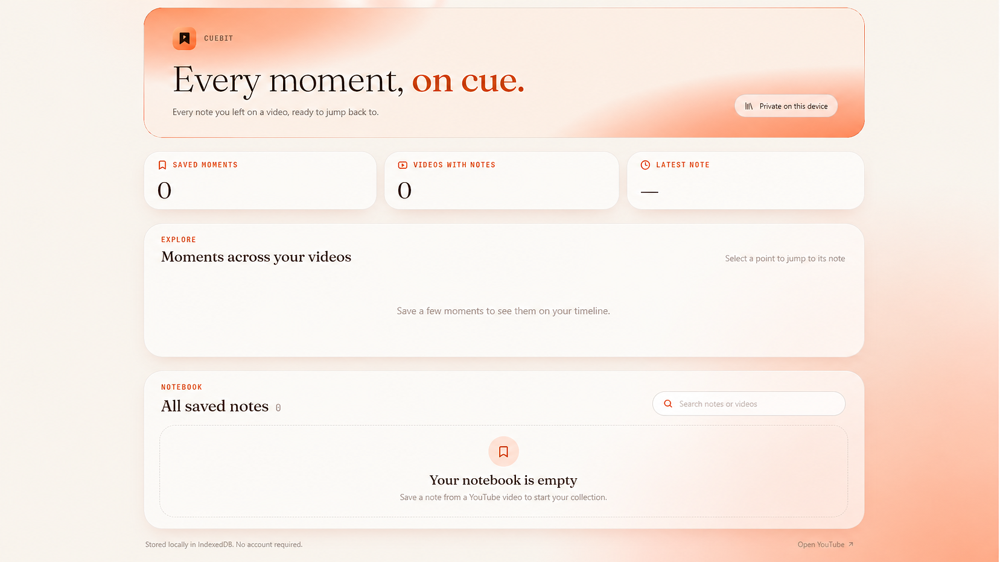

# CueBit

CueBit is a browser extension that saves a short note at an exact point in a YouTube video, so you can return to it from the player or from your private library.




## Features

- Save the current video time and a note from the extension popup
- Save from a bookmark button beside YouTube's player controls, with an inline note form
- Keyboard shortcuts: `B` on the video page, or `Alt+Shift+N` from anywhere on the tab (rebind at `chrome://extensions/shortcuts`)
- Saved moments appear as markers on the seek bar; click one to jump to that time
- Library page to browse, search, open, and delete notes, with a timeline visualization
- Warm cream and orange interface across the popup, library, and player overlay
- Notes are stored locally in IndexedDB. No account, server, or subscription

## Install

CueBit is not on the Chrome Web Store, so you load it unpacked.

### Option 1: Download the release (no build needed)

1. Download `cuebit-<version>-chrome.zip` from the [Releases](../../releases) page and extract it.
2. Open `chrome://extensions` (or `brave://extensions`, `edge://extensions`) and turn on **Developer mode**.
3. Click **Load unpacked** and select the extracted folder (the one containing `manifest.json`).
4. Pin CueBit to your toolbar, then reload any YouTube tab that was already open.

> Chrome can't load a zip directly with **Load unpacked**, so extract it first.

### Option 2: Build from source

You need Node.js 20 or newer and Git.

1. Clone this repository.
2. Install dependencies and build:

   ```sh
   npm install
   npm run build
   ```

3. Open `chrome://extensions` (or `brave://extensions`, `edge://extensions`) and turn on **Developer mode**.
4. Click **Load unpacked** and select the generated `.output/chrome-mv3` folder.
5. Pin CueBit to your toolbar, then reload any YouTube tab that was already open.

## Use

1. Open a YouTube video (`youtube.com/watch?v=...`).
2. Click the bookmark button beside the player controls, press `B`, press `Alt+Shift+N`, or open the CueBit popup.
3. Type a short note and choose **Save note** (or press `Ctrl+Enter`).
4. A marker appears on the seek bar. Click it later to jump back to that moment.

Open **Library** in the popup to search notes by text or video title, open a note at its saved time, or delete it. Deletion is immediate.

## Good to know

- Works on desktop Chromium browsers such as Chrome, Brave, and Edge. A Firefox build is available with `npm run build:firefox` but has not been tested.
- Notes belong to one browser profile and do not sync between browsers or computers.
- Removing the extension or clearing its data can delete your notes. Export and import are not included yet.
- YouTube may change its page layout, which can affect the player button or markers.
- Common setup problems are covered in [docs/TROUBLESHOOTING.md](docs/TROUBLESHOOTING.md).

## How it works

A content script runs on `youtube.com`. It reads the current video and time, adds the player button, note form, and seek-bar markers, and sends note operations to the extension's background worker. The worker writes notes to an IndexedDB database named `youtube-moment-notes`, which the popup and library read.

## Privacy

CueBit runs entirely in your browser. It has no server, no analytics, and sends no data anywhere. See [PRIVACY.md](PRIVACY.md).

## Permissions

| Permission | Why it is needed |
|---|---|
| `activeTab`, `scripting` | Read the video and time on the tab you are using |
| Access to `https://www.youtube.com/*` | Add the player button, note form, and seek-bar markers |

## Development

```sh
npm run dev          # Chromium development build with rebuilds
npm run build        # Chromium production build
npm run zip          # Package the production build
npm run dev:firefox  # Firefox development build
npm run build:firefox
```

Built with WXT, TypeScript, React, Tailwind CSS, `idb`, Day.js, and Plotly.js. Generated output goes to `.output/` and is git-ignored. After changes, reload the extension and the YouTube tab. See [docs/PROJECT-GUIDE.md](docs/PROJECT-GUIDE.md) and [docs/DESIGN.md](docs/DESIGN.md) for more.

### Project layout

```
entrypoints/   Background worker, popup, library dashboard, YouTube content script
src/           Shared components, database, messaging, types, styles
public/icon/   Extension icons
docs/          Design, project, and troubleshooting guides
wxt.config.ts  WXT setup and manifest (permissions, icons, shortcut)
```

## Contributing

Issues and pull requests are welcome. Read [CONTRIBUTING.md](CONTRIBUTING.md) first.

## Security

To report a vulnerability, see [SECURITY.md](SECURITY.md).

## Disclaimer

CueBit is an independent project and is not affiliated with, endorsed by, or sponsored by YouTube or Google. YouTube and Google are trademarks of Google LLC.

## Credits

CueBit is a redesign of the original [YouTube Moment Notes](https://github.com/dev-x-ayush/Youtube-moments-bookmarks) extension by dev-x-ayush, with a new design, theme, branding, and bug fixes.

## License

Code is released under the [MIT License](LICENSE). The bundled fonts (Fraunces, Geist, JetBrains Mono) are licensed under the SIL Open Font License 1.1; see [THIRD_PARTY_NOTICES.md](THIRD_PARTY_NOTICES.md).
